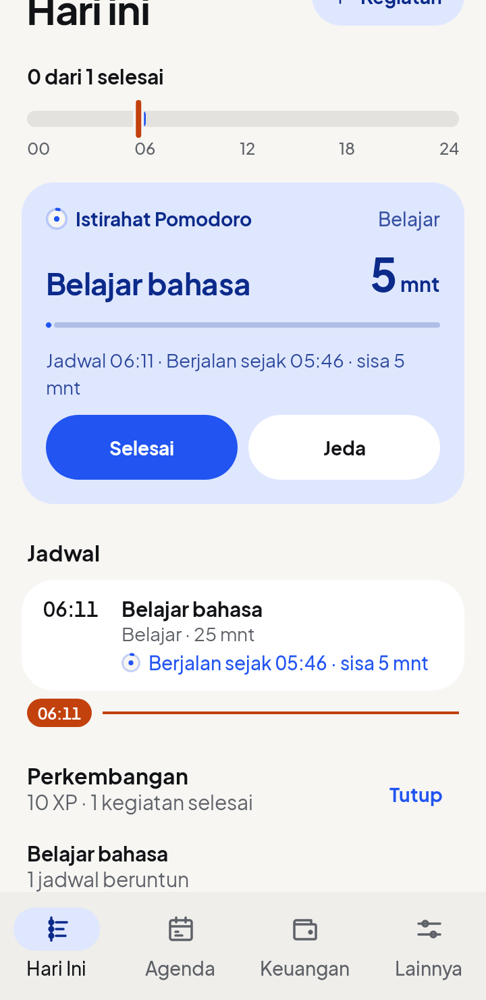
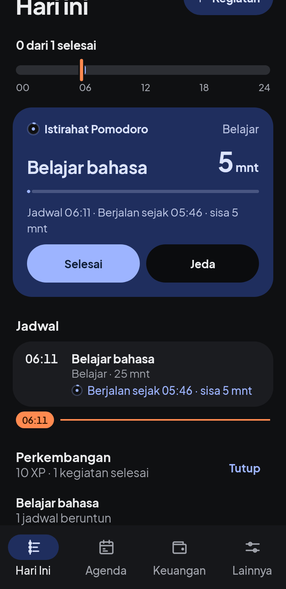

# Ritme

Ritme membantu mengatur kegiatan harian, rutinitas, dan catatan keuangan dalam satu aplikasi Android. Semua berjalan di perangkat tanpa akun, iklan, atau koneksi internet.

[Unduh Ritme untuk Android](https://github.com/noetherianism/Ritme/releases/latest)

Ritme masih dalam tahap pengembangan versi 0.x. Saat ini tersedia untuk Android 8 atau lebih baru.

Gambar memakai data contoh untuk memperlihatkan tampilan aplikasi.

## Yang bisa dilakukan

- Atur kegiatan sekali jalan dan rutinitas berulang. Mulai, tunda, lewati, atau selesaikan langsung dari notifikasi.
- Pakai Pomodoro bila diperlukan untuk kegiatan Belajar atau Kerja, dengan 25 menit fokus dan 5 menit istirahat.
- Lihat perkembangan kegiatan melalui streak sesuai jadwal dan XP sederhana.
- Catat pemasukan, pengeluaran, transfer, anggaran, dan refund. Impor dari notifikasi bank atau dompet digital bersifat opsional dan hanya membaca notifikasi baru yang Anda izinkan.
- Aktifkan jadwal sholat dan pengingatnya bila dibutuhkan.
- Simpan salinan data dalam berkas backup terenkripsi yang Anda pegang sendiri.

Ritme tidak meminta izin internet. Data kegiatan dan keuangan tetap di HP. Backup memerlukan kata sandi yang Anda tentukan sendiri.

## Memasang

Unduh berkas APK dari halaman [Releases](https://github.com/noetherianism/Ritme/releases), lalu buka berkas itu di HP. Petunjuk pembaruan dan pemindahan data ada di [Cara pasang](CARA-PASANG.md).

Jika Ritme versi debug sudah terpasang, buat backup terenkripsi terlebih dahulu. APK unduhan publik memakai tanda tangan baru sehingga tidak dapat dipasang langsung sebagai pembaruan versi debug.

## Status pengujian

Versi 0.4.3 telah melewati 402 tes logika dan 6 tes perangkat di Samsung A54 Android 16. Tujuh langkah alur notifikasi dengan layar menyala juga lulus. Alarm saat layar mati, Doze, restart fisik, dan beberapa alur antarmuka masih perlu diuji lebih jauh. Lihat [catatan versi](https://github.com/noetherianism/Ritme/releases/latest) untuk hasil terbaru.

## Masukan

Masalah penggunaan dan saran dapat ditulis di [Issues](https://github.com/noetherianism/Ritme/issues). Jangan sertakan nomor rekening, isi notifikasi bank, kata sandi backup, atau data pribadi. Untuk laporan celah keamanan, gunakan pelaporan privat GitHub jika tersedia.

Repositori ini hanya untuk informasi dan unduhan aplikasi. Kode sumber serta kunci penandatanganan tidak disimpan di sini.
